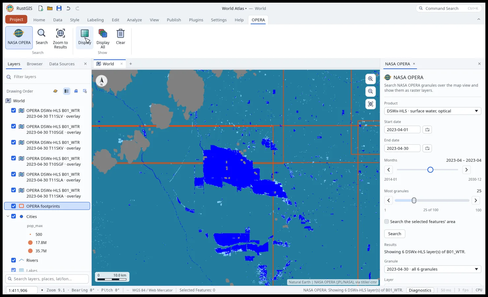
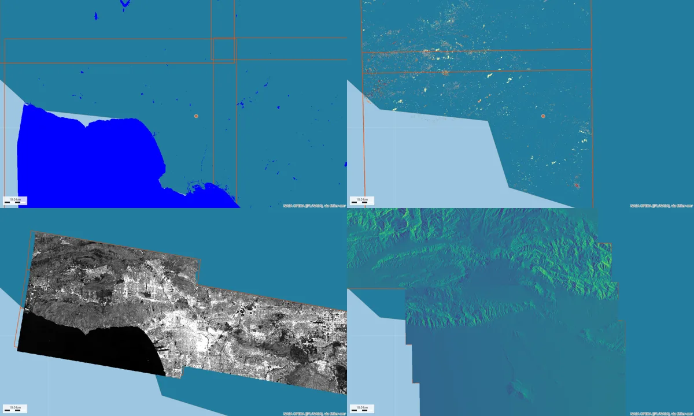

# NASA OPERA for RustGIS

A [RustGIS](https://github.com/opengeos/RustGIS) plugin to search and visualize
[NASA OPERA](https://www.jpl.nasa.gov/go/opera) products (surface water, land disturbance, SAR
backscatter and more) on the map. It is the RustGIS counterpart of the
[GeoLibre NASA OPERA plugin](https://github.com/opengeos/geolibre-nasa-opera) and the
[QGIS NASA OPERA plugin](https://github.com/opengeos/qgis-nasa-opera-plugin).

It is a sandboxed WebAssembly plugin, so it runs in the desktop app, in `rustgis-cli` and in the
[web app](https://web.rustgis.app). It needs **no Earthdata login**: granule search uses NASA's
public [CMR](https://cmr.earthdata.nasa.gov/search) API, and rasters are drawn by
[titiler-cmr](https://github.com/developmentseed/titiler-cmr), which reads the Cloud-Optimized
GeoTIFFs with Earthdata credentials of its own.



## What it does

The plugin has a ribbon tab of its own, **OPERA**, with the panel's button, Search, Zoom to
Results, Display, Display All and Clear.

- In the **NASA OPERA** panel, pick a **product** from the dropdown, a **start date** and an
  **end date** (each a date box with a calendar), or drag the two handles of the **Months** range
  to set them to whole months, then **Search**. With no dates it finds the latest granules. It
  searches the map view, or the selected features' area when *Search the selected features' area*
  is ticked.
- The granules' **footprints** go on the map as the layer `OPERA footprints` (hollow orange
  outlines), and the **Granule** dropdown lists them by date, newest first: each date (all its
  granules together, a mosaic of the tiles acquired that day), then its granules.
- Choose a date or a granule: its footprints are selected on the map and the **Layer** dropdown
  lists its datasets (bands). Selecting footprints on the map works too: **Display** shows the
  selected ones.
- **Display** adds each granule as a tile layer (`OPERA DSWx-HLS B01_WTR 2023-04-30 T11SKA`),
  newest on top, at most 25 at a time. **Display All** shows the newest granule of each tile
  found that has the chosen layer, at most 25 tiles: older dates of a tile would lie beneath it, and each layer slows
  panning.
- Categorical layers get their classes' colours: DSWx water classes (with *water classes only*
  to hide cloud, snow and ocean) and DIST disturbance status. Continuous layers get a stretch and
  a colormap (SAR backscatter in grey, DEM in `terrain`, confidence and incidence angles in
  `viridis`); scripts can set `rescale` and `colormap` themselves. **Opacity** applies to the
  layers being added.
- **Zoom to Results** and **Clear** (removes the footprints and every OPERA layer).
- The plugin carries an AI Assistant skill, `nasa-opera:opera-flood-map`, that teaches the
  assistant to map floods, water and disturbance with these commands.

### Products

| Product | Short name | Shown as |
|---|---|---|
| DSWx-HLS: surface water, optical | `OPERA_L3_DSWX-HLS_V1` | `B01_WTR` water classes, and 9 more bands |
| DSWx-S1: surface water, radar | `OPERA_L3_DSWX-S1_V1` | `B01_WTR` water classes |
| DIST-ALERT: disturbance alerts | `OPERA_L3_DIST-ALERT-HLS_V1` | `VEG-DIST-STATUS` classes |
| DIST-ANN: annual disturbance | `OPERA_L3_DIST-ANN-HLS_V1` | `VEG-DIST-STATUS` classes |
| RTC-S1: SAR backscatter | `OPERA_L2_RTC-S1_V1` | `VV`/`VH` in grey |
| RTC-S1 static layers | `OPERA_L2_RTC-S1-STATIC_V1` | `local_incidence_angle` and more |
| CSLC-S1, CSLC-S1 static, DISP-S1 | `OPERA_L2_CSLC-S1_V1`, `OPERA_L2_CSLC-S1-STATIC_V1`, `OPERA_L3_DISP-S1_V1` | footprints only (HDF5 and NetCDF, which titiler-cmr's raster reader doesn't take) |



## Install

Download `nasa-opera-<version>.rgplugin` from the
[latest release](https://github.com/opengeos/rustgis-nasa-opera/releases/latest) and install it
with **Plugins › Install From File** (or drop it on the RustGIS window), or on the command line:

```sh
rustgis-cli plugins install nasa-opera-0.2.0.rgplugin
```

Its panel uses dropdowns, date pickers and a range slider, which come after RustGIS 0.6.0 (in
RustGIS's `main` now, and in 0.7.0); in 0.6.0 itself the plugin doesn't load. The install prompt
lists its permissions: **edit** (it adds the footprints and tile layers) and **network** (it
reads `cmr.earthdata.nasa.gov` and adds tiles from `titiler-cmr.opengeos.org`; it contacts no
other host).

## Use it from scripts and the command line

Every command takes its settings as parameters too, so scripts, the AI Assistant and
`rustgis-cli` can use it without the panel:

```sh
rustgis-cli run --plugin nasa-opera-0.2.0.rgplugin \
  --cmd 'plugin:nasa-opera/search={"product": "OPERA_L3_DSWX-HLS_V1", "bbox": [-119.95, 35.85, -119.45, 36.25], "start": "2023-04-01", "end": "2023-04-30", "limit": 50}' \
  --cmd 'plugin:nasa-opera/display={"date": "2023-04-30", "band": "B01_WTR", "waterOnly": true}' \
  --cmd 'map.zoomToExtent={"extent": [-120.2, 35.75, -119.2, 36.35]}' \
  --cmd 'share.exportMap={"path": "tulare.png"}'
```

| Command | Parameters |
|---|---|
| `search` | `product`, `bbox` `[w, s, e, n]` (default: the map view), `start` and `end` `"YYYY-MM-DD"`, or `latest: true` (default: the panel's dates, or the latest when both are empty), `limit` 1–100 |
| `sync-dates` | `{"panel": {"months": [low, high]}}` sets the dates from the month range; `{"panel": {"start", "end"}}` moves the range to the dates' months |
| `choose-granule` | `granule` (a granule UR) or `date` |
| `display` | `granule` or `date` (default: the selected footprints, else the panel's choice), `band`, `rescale` `"min,max"`, `colormap` (a titiler colormap name), `waterOnly`, `opacity` 0–100 |
| `display-all` | `band`, `rescale`, `colormap`, `waterOnly`, `opacity` |
| `zoom-results`, `clear`, `panel-state` | none |

`search` answers `granules`, `hits` and `dates` (newest first); `display` answers the `layers` it
added.

## How it works

```
Search  ──> host.fetch  https://cmr.earthdata.nasa.gov/search/granules.umm_json   (public)
             ?short_name=…&bounding_box=…&temporal=…&sort_key=-start_date&page_size=25&page_num=…
        ──> footprints layer, whose attributes hold each granule's UR, date, tile, collection and bands

Display ──> map.addTiles  https://titiler-cmr.opengeos.org/rasterio/tiles/WebMercatorQuad/{z}/{x}/{y}.png
             ?collection_concept_id=…&granule_ur=…&assets=<band>&assets_regex=<band>&colormap=…
```

A plugin keeps nothing between calls, so the footprints layer is its memory: Display reads the
granules back from it. CMR answers are fetched 25 granules a page (each page stays under
`host.fetch`'s 2 MB), all pages at once so the web app downloads them together, and read into
typed structs that skip what the plugin doesn't use, so a 100-granule search fits a command's
fuel budget. Reprocessed granules that CMR lists beside the ones they replace are left out.

## Develop

You need [Rust](https://rustup.rs) with `rustup target add wasm32-unknown-unknown`, and
Python 3.11 or later.

```sh
cargo test                       # unit tests (src/opera.rs: CMR parsing, dates, tile addresses)
python scripts/package.py        # builds dist/nasa-opera-<version>.rgplugin and checks it as the registry does
python scripts/smoke.py          # loads it in rustgis-cli on the World Atlas sample
pre-commit run --all-files       # cargo fmt and clippy
```

To try a build in the desktop app, add `dist/nasa-opera` with
**Plugins › Plugin Manager › Settings › Add Plugin Folder…**.

| Path | What |
|---|---|
| `plugin.json` | the manifest: commands, panel, permissions, skill |
| `src/lib.rs` | the commands and the panel |
| `src/opera.rs` | products, CMR results, dates, styles and titiler-cmr addresses (no host calls, unit tested) |
| `skills/opera-flood-map/SKILL.md` | the AI Assistant skill packaged with the plugin |
| `scripts/package.py` | builds, checks and packages the plugin (with its skills) into `dist/` |
| `scripts/smoke.py` | runs the package in `rustgis-cli` |

## Release

Bump `version` in `plugin.json` and `Cargo.toml`, then push a matching tag (`v0.1.0`). The
[Release](.github/workflows/release.yml) workflow builds, checks and runs the plugin, then
publishes the `.rgplugin` and its registry entry `nasa-opera.json`.

## Credits

OPERA products are produced by NASA JPL's
[Observational Products for End-Users from Remote Sensing Analysis](https://www.jpl.nasa.gov/go/opera)
project and distributed by NASA's PO.DAAC, LP DAAC and ASF DAAC. Tiles are rendered by
[titiler-cmr](https://github.com/developmentseed/titiler-cmr) from Development Seed.

## License

MIT
